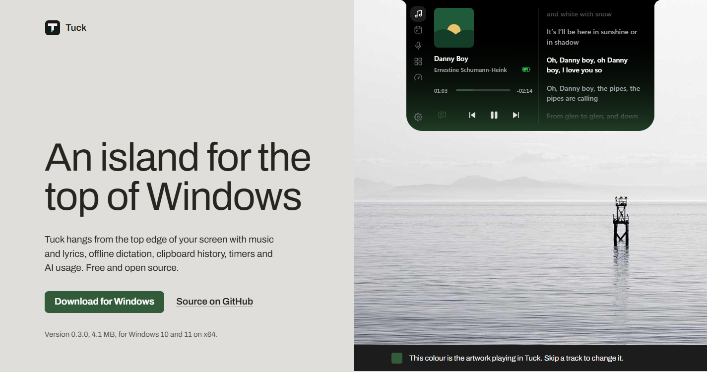
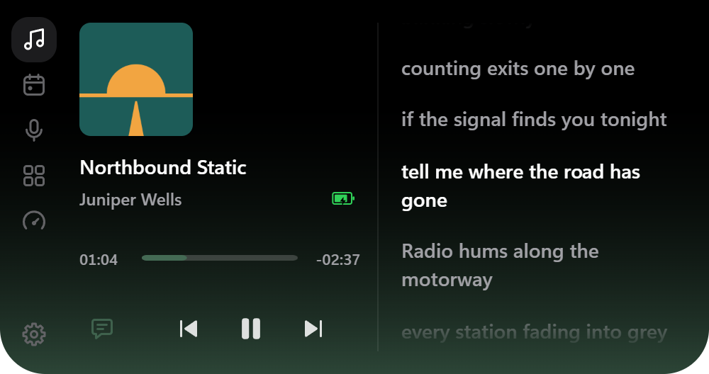
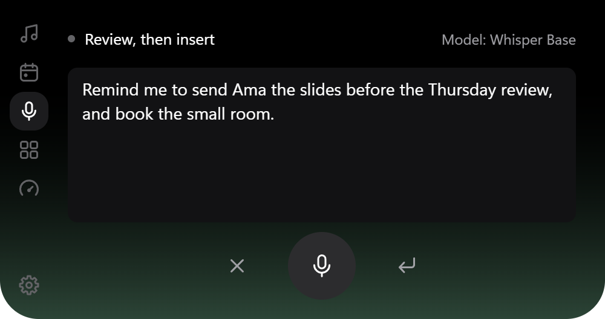
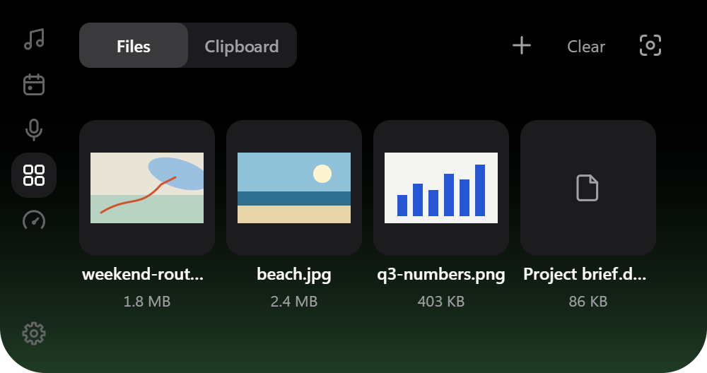
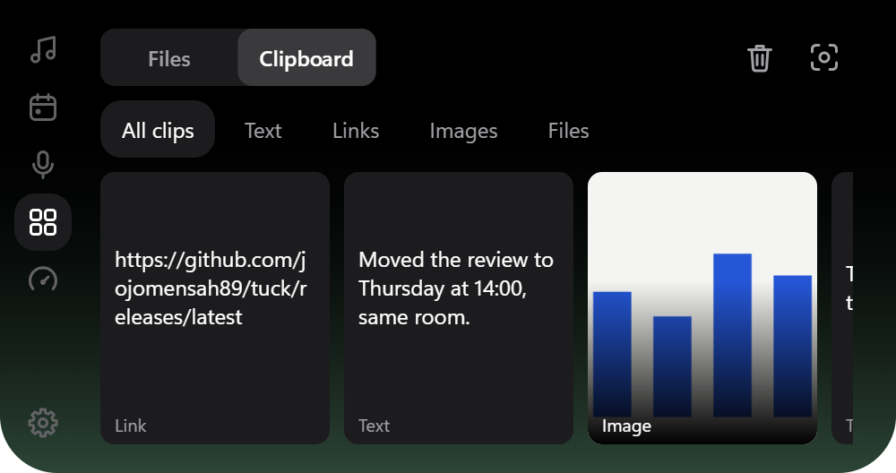
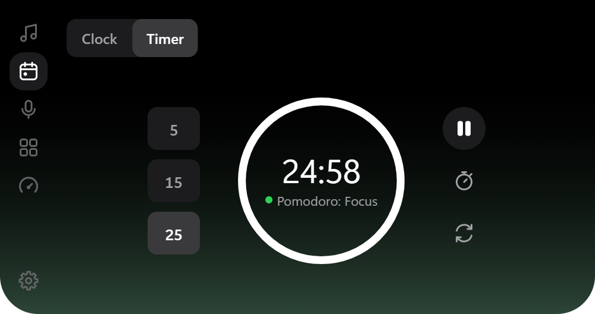
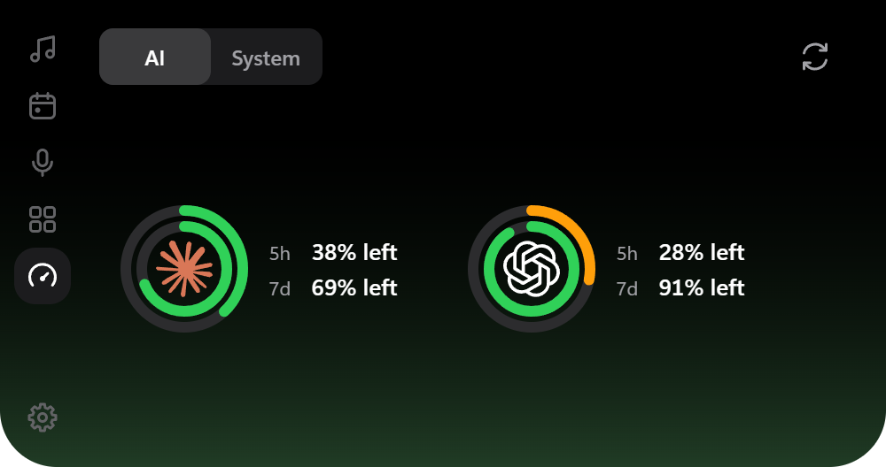
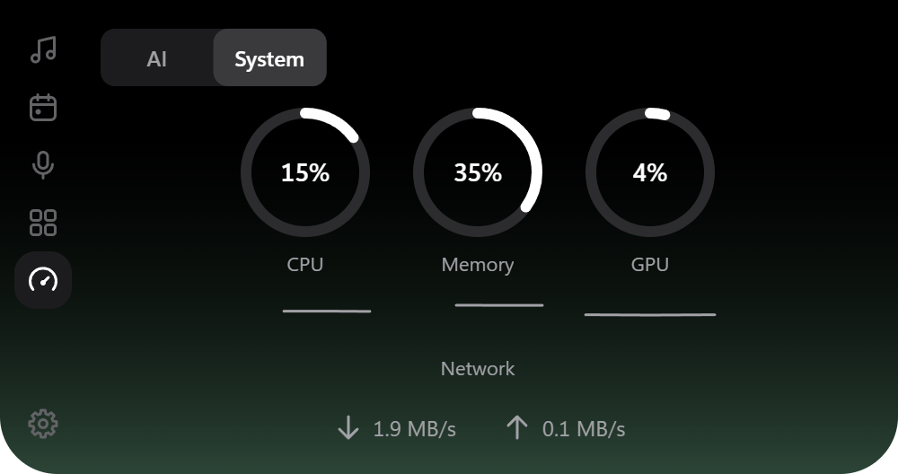

<div align="center">

# Tuck

**An island for the top of Windows.**

Tuck hangs from the top edge of your screen with music and lyrics, offline dictation, clipboard history, timers and AI usage. Free and open source.

[](https://github.com/jojomensah89/tuck/releases/latest)
[](./LICENSE)
[](#requirements)
[](https://github.com/jojomensah89/tuck/releases)
[](https://github.com/jojomensah89/tuck)
[](https://github.com/jojomensah89/tuck/issues)
[](https://github.com/jojomensah89/tuck/commits)

[Website](https://tuck.jojomensah.com) · [Download](https://github.com/jojomensah89/tuck/releases/latest) · [Install](#installing-it) · [Privacy](#what-leaves-your-pc) · [Build from source](#build-from-source)



</div>

## What it holds

<table>
<tr>
<td width="50%"></td>
<td width="50%">

**Music and its lyrics**

Anything that shows in the Windows media overlay: Spotify, Apple Music, YouTube in a browser. Skip, pause and seek without finding the window. Synced lyrics come from LRCLIB, and you choose which apps drive the card.

</td>
</tr>
<tr>
<td width="50%">

**Dictation that stays on your PC**

Hold a shortcut, speak, let go. Whisper or Parakeet turns it into text on your own processor, and Tuck types it where your cursor is. With no text box focused it copies the text and says so.

</td>
<td width="50%"></td>
</tr>
<tr>
<td width="50%"></td>
<td width="50%">

**A shelf for files**

Drop files on the island to keep them close while you work, then drag them out into a chat, an email or a folder. The shelf remembers where files live. It never moves or copies them.

</td>
</tr>
<tr>
<td width="50%">

**Clipboard history**

Text, links, images and file paths you copied, as cards you can click to copy again or pin. It is off until you turn it on, and forgotten when Tuck closes unless you choose to keep it.

</td>
<td width="50%"></td>
</tr>
<tr>
<td width="50%"></td>
<td width="50%">

**Clock, timers and focus**

A 5, 15 or 25 minute timer in one click, a stopwatch, and Pomodoro rounds that keep counting in the resting island. The clock page shows the date and your battery.

</td>
</tr>
<tr>
<td width="50%">

**What is left of your AI quota**

Claude, Codex and Antigravity limits as rings: the five-hour window outside, the week inside. Each provider is off until you switch it on, and only offered when its app is installed.

</td>
<td width="50%"></td>
</tr>
<tr>
<td width="50%"></td>
<td width="50%">

**Your PC at a glance**

CPU, memory and graphics as rings, with download and upload speed read from Windows' own counters. Measured only while you are looking at it.

</td>
</tr>
</table>

Tuck rests as a small black shape at the top of the screen and draws nothing while nothing changes. Point at it and it opens. It also has tray controls, keyboard navigation and optional startup at sign-in.

## Light on your PC

| | |
| --- | --- |
| **0%** | CPU while Tuck rests, measured over 30 seconds on a 16-thread PC. |
| **5 MB** | What Task Manager shows for Tuck while it rests at the top of your screen. |
| **4.1 MB** | The installer. Speech models download separately, only when you pick one. |
| **6 h** | How often Tuck asks GitHub for an update. It downloads one only when you click. |
| **Off** | Clipboard history and every AI provider until you turn them on. |
| **256 MB** | The most clipboard history it will ever keep on disk, and only with Keep after restart. |

## Requirements

Windows 10 or 11 on x64, with Microsoft Edge WebView2 Runtime installed (Windows already includes it). Offline dictation needs an AVX2-capable CPU and a downloaded speech model. Model sizes vary; check the picker before downloading.

## Installing it

1. **Download the installer** from [GitHub Releases](https://github.com/jojomensah89/tuck/releases/latest). One file, about 4.1 MB. Tuck installs for your user only.
2. **Windows will warn you about it.** Tuck is new and not yet signed with a paid certificate, so SmartScreen does not know it. Check that the installer came from this repository, then choose **More info**, then **Run anyway**.
3. **It appears at the top of your screen.** A short welcome asks whether to start with Windows, track AI usage and pick a dictation model. Every answer can change later.

The release workflow signs updater packages, but does not apply Windows Authenticode signing, so the warning stays until a code-signing certificate is in place.

### Updates

Tuck checks for updates about 20 seconds after startup and every six hours. Settings > About and the tray can also check. Downloads start only after you choose Download and install, and update signatures are checked before installation. That signature does not remove the SmartScreen warning.

## What leaves your PC

Speech recognition runs on your computer, and the app has no analytics. Here is what does touch the network, and how your data is kept.

<details>
<summary><strong>Network contacts</strong></summary>

<br>

Tuck is not fully offline.

- Updates contact GitHub.
- Optional model downloads contact Hugging Face.
- Lyrics requests send track details to LRCLIB.
- Claude and Codex each start off; their switches appear only when their executable is found.
  - With Claude on, Tuck asks Claude Code for limits and the client may contact Anthropic. The optional Tuck status-line file is local.
  - With Codex on, Tuck asks its app-server for limits and the client may contact OpenAI.
  - Turning either off cancels its reader and removes its rings.
- Antigravity is a separate opt-in, off by default.
  - Its switch appears only if `%USERPROFILE%/.gemini/antigravity-acp/acp_token.json` exists (existence only).
  - Turning it on requires confirmation that Tuck reads that sign-in file and contacts Google for quota. This is the only exception to the no-other-app-credential-files rule.
  - Rust reads at most 16 KiB, keeps credentials only during the request, and never writes the file.
  - OAuth refresh goes to `oauth2.googleapis.com`; quota goes to `daily-cloudcode-pa.googleapis.com` and `cloudcode-pa.googleapis.com`, using HTTPS with redirects disabled and timeouts. No userinfo, login or prompts.
  - Turning it off cancels requests, drops secrets and removes the ring.
  - It relies on an undocumented Google service that may stop working.
- Network speeds use local Windows interface counters only while System is visible in the open island, without network requests.

The website at tuck.jojomensah.com counts visits with a self-hosted counter that sets two first-party cookies and shares nothing with ad networks.

</details>

<details>
<summary><strong>Dictation, microphone and clipboard</strong></summary>

<br>

- Dictation uses temporary clipboard paste, restores supported prior contents when unchanged, and requests exclusion from Windows history and cloud sync.
- Dictation settings and downloaded models are stored locally.
- Dictation keeps the microphone ready by default once a speech model is available. Windows shows microphone use while Tuck runs. Turn off **Keep microphone ready** in Settings to open it only while dictating. Idle audio stays in an erased, ten-second memory buffer; recordings include up to 450 ms before press and a short tail after release.
- Microphone mute uses Ctrl+Alt+M (change or turn it off in Settings > Privacy). Starting dictation while muted reports "Microphone is muted".
- The optional microphone and camera indicator names apps reported as in use by Windows. It keeps no usage history and sends nothing.
- Clipboard history is off by default. When enabled it keeps text, images and file paths, never the contents of copied files. Sensitive content in images is not detected. Private clipboard markers and Tuck's own dictation paste are skipped.
- History stays in memory and vanishes on exit unless **Keep after restart** is on; then it is saved only in Tuck's app data, bounded to 256 MB including images.
- Removing a clip deletes its saved data. Clear all deletes unpinned clips and keeps pins. Turning history off deletes all saved clips, including pins.
- Settings > Island > Placement picks the monitor and whether the island sits left, centre or right. Both are saved on your computer, by the monitor's device path and name, and the island moves back to the primary monitor while the chosen one is unplugged.

Local processing does not mean local files are encrypted. Treat your Windows account and local app data as sensitive.

</details>

## Build from source

Install Bun (CI uses 1.4.2), stable Rust with the MSVC target, Microsoft C++ Build Tools with the Windows SDK, Python, WebView2, and CMake 3.22 or newer. Install CMake with `winget install Kitware.CMake` and make its bin directory available on PATH.

Windows source builds also require the Vulkan SDK (`winget install KhronosGroup.VulkanSDK`). CI installs the SDK and SPIRV headers. Installed apps use the graphics driver's Vulkan 1.2 loader, with CPU fallback; do not distribute `vulkan-1.dll`.

```powershell
bun install --frozen-lockfile
. .\scripts\prepare-native.ps1 -InstallBuildTools
bun run tauri dev
```

The script installs pinned libclang into the repository's ignored artifacts directory. In each new shell, dot-source it without `-InstallBuildTools` before running Cargo. `bun run dev` opens a browser demo with test data.

```powershell
. .\scripts\prepare-native.ps1
bun run tauri build
```

Installers are written to `src-tauri/target/release/bundle/nsis/`.

## Documentation

- [Contributing and checks](CONTRIBUTING.md)
- [Releasing and updates](docs/releasing.md)
- [Installed-client usage](docs/installed-client-usage.md)
- [Model attribution](THIRD_PARTY_NOTICES.md)
- [Support](SUPPORT.md) and [security reports](SECURITY.md)

## Licence

[MIT](LICENSE), copyright 2026 Tuck contributors. Third-party components and model weights retain their own terms.

<div align="center">

<a href="https://tuck.jojomensah.com">tuck.jojomensah.com</a> · <a href="https://github.com/jojomensah89/tuck/releases/latest">Latest release</a>

</div>
