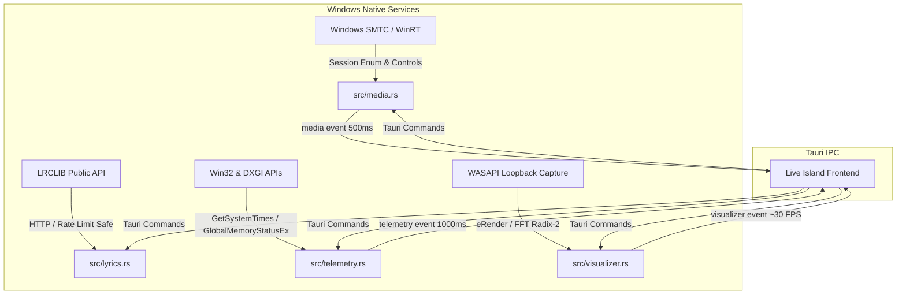

> Historical plan or verification record. This is not the current feature list or setup guide. Some described features are being retired. Start with the [README](../README.md).

# Live Island Phase Two Native Media, Lyrics, Telemetry & Visualizer Architecture

## 1. Overview & Architecture

This document specifies the Phase Two Windows native backend architecture for Tuck (`jojomensah89/tuck`), implementing full real-time media management, LRCLIB synchronized lyrics, hardware telemetry, and WASAPI audio loopback visualization.

### Architecture Topology



### Safety & Boundary Guarantees
1. **Zero Fake Telemetry / No Arbitrary Percentage Summing:**
   - Multi-adapter GPU enumeration reports actual hardware adapters via DXGI.
   - Per-engine GPU utilization is never arbitrarily summed (which causes false >100% spikes across 3D, Video Decode, Copy, Compute engines). Peak engine utilization is reported, or `null` when performance query counters are unavailable.
   - First CPU sample explicitly returns `status: "warming_up"` with `cpu: null`, never fabricating a fake `0.0%`.
2. **WASAPI Loopback Capture Security:**
   - Strictly captures audio from the default audio playback render endpoint (`eRender`, `eConsole`).
   - **Never captures from microphones** or audio recording inputs.
   - **Zero file retention**: samples are read directly into an in-memory 512-sample circular buffer, analyzed by FFT, and immediately overwritten. Audio is never saved to disk.
   - Clean COM lifecycle with `CoInitializeEx(COINIT_MULTITHREADED)` and `CoUninitialize()` on teardown.
3. **Bounded Memory & Rate-Limited Network:**
   - LRCLIB requests use standard HTTP client with 5-second timeouts, custom `Tuck/0.1.0` User-Agent, and respect HTTP 429 `Retry-After` backoff.
   - Lyrics cache is strictly bounded (max 128 items).
   - SMTC thumbnail stream reads are bounded to 5 MB maximum to avoid memory bloat.
   - Stale request rejection: responses carry sequence tokens and track IDs to reject out-of-order responses when tracks change mid-request.
4. **Window Access Control:**
   - Sensitive mutation commands (`media_select_session`, `lyrics_set_enabled`, `lyrics_clear_cache`, `visualizer_set_enabled`, `visualizer_set_reduced_motion`) verify caller window label is `"main"` or `"settings"`.

---

## 2. Command Reference & Signatures

### Media (`src-tauri/src/media.rs`)

| Command | Type | Arguments | Return Type | Description |
| :--- | :--- | :--- | :--- | :--- |
| `media_now` | Sync | None | `MediaState` | Returns the current media snapshot cached by the poller |
| `media_sessions` | Async | None | `Result<Vec<MediaSessionInfo>, String>` | Enumerates all active Windows SMTC media sessions |
| `media_select_session` | Sync | `session_id: Option<String>` | `Result<(), String>` | Selects a specific media player session or clears selection (restricted to `main`/`settings`) |
| `media_toggle` | Async | None | `Result<(), String>` | Toggles play/pause on the active session |
| `media_next` | Async | None | `Result<(), String>` | Skips to next track |
| `media_prev` | Async | None | `Result<(), String>` | Skips to previous track |
| `media_seek` | Async | `ms: i64` | `Result<(), String>` | Seeks to millisecond timestamp (clamped to track duration) |

### Lyrics (`src-tauri/src/lyrics.rs`)

| Command | Type | Arguments | Return Type | Description |
| :--- | :--- | :--- | :--- | :--- |
| `lyrics_status` | Sync | None | `LyricsConfig` | Returns current opt-in status |
| `lyrics_set_enabled` | Sync | `enabled: bool` | `Result<(), String>` | Enables/disables lyrics fetching (restricted to `main`/`settings`) |
| `lyrics_clear_cache` | Sync | None | `Result<(), String>` | Clears bounded lyrics cache (restricted to `main`/`settings`) |
| `lyrics_get` | Async | `title: String`, `artist: String`, `duration_ms: i64`, `track_id: Option<String>` | `Result<LyricsResponse, String>` | Fetches and parses lyrics from LRCLIB |

### Telemetry (`src-tauri/src/telemetry.rs`)

| Command | Type | Arguments | Return Type | Description |
| :--- | :--- | :--- | :--- | :--- |
| `telemetry_now` | Sync | None | `Result<TelemetrySnapshot, String>` | Returns current CPU, RAM, and GPU telemetry snapshot |
| `telemetry_history` | Sync | None | `Result<Vec<TelemetryHistoryPoint>, String>` | Returns circular history of the last 60 seconds (1 point/sec) |

### Visualizer (`src-tauri/src/visualizer.rs`)

| Command | Type | Arguments | Return Type | Description |
| :--- | :--- | :--- | :--- | :--- |
| `visualizer_status` | Sync | None | `VisualizerStatus` | Returns whether visualizer capture is enabled and active |
| `visualizer_set_enabled` | Sync | `enabled: bool` | `Result<(), String>` | Starts/stops WASAPI loopback capture (restricted to `main`/`settings`) |
| `visualizer_set_reduced_motion` | Sync | `enabled: bool` | `Result<(), String>` | Sets heavy smoothing and frequency dampening for reduced motion |
| `visualizer_spectrum` | Sync | None | `Result<VisualizerSnapshot, String>` | Returns current frequency spectrum snapshot |

---

## 3. Data Transfer Objects (DTOs) & Events

All DTOs serialize strictly with `camelCase` keys.

### Media DTOs
```typescript
interface MediaState {
  active: boolean;
  trackId: string;
  title: string;
  artist: string;
  playing: boolean;
  positionMs: number;
  durationMs: number;
  artwork: string | null;
  sessionId: string | null;
  sourceAppId: string | null;
  canPlayPause: boolean;
  canSkipNext: boolean;
  canSkipPrev: boolean;
  canSeek: boolean;
  generation: number;
}

interface MediaSessionInfo {
  id: string;
  sourceAppId: string;
  title: string;
  artist: string;
  playing: boolean;
  isSelected: boolean;
}
```

### Lyrics DTOs
```typescript
interface LyricsConfig {
  enabled: boolean;
}

interface LyricLine {
  timeMs: number;
  text: string;
}

interface LyricsResponse {
  status: "synced" | "plain" | "instrumental" | "not_found" | "disabled" | "error";
  trackId: string | null;
  title: string;
  artist: string;
  instrumental: boolean;
  plainLyrics: string | null;
  syncedLyrics: LyricLine[] | null;
  errorMessage: string | null;
  requestSeq: number;
}
```

### Telemetry DTOs
```typescript
interface CpuStats {
  usagePercent: number;
  frequencyMhz: number | null;
}

interface RamStats {
  totalBytes: number;
  usedBytes: number;
  freeBytes: number;
  usagePercent: number;
}

interface GpuStats {
  name: string;
  vendor: string;
  usagePercent: number | null;
  memoryUsedBytes: number | null;
  memoryTotalBytes: number | null;
}

interface TelemetryHistoryPoint {
  timestampMs: number;
  cpuPercent: number | null;
  ramPercent: number | null;
  gpuPercent: number | null;
}

interface TelemetrySnapshot {
  status: "warming_up" | "ready" | "stale" | "unavailable";
  cpu: CpuStats | null;
  ram: RamStats | null;
  gpus: GpuStats[];
  history: TelemetryHistoryPoint[];
  sampleTimeMs: number;
}
```

### Visualizer DTOs
```typescript
interface VisualizerStatus {
  enabled: boolean;
  active: boolean;
  reducedMotion: boolean;
  binCount: number; // 16 bins
}

interface VisualizerSnapshot {
  bins: number[]; // Array of 16 floats normalized in [0.0, 1.0]
  energy: number; // RMS energy in [0.0, 1.0]
  isSilent: boolean;
}
```

### Tauri Events
- `"media"`: Emitted every 500ms when media state or playback advances. Payload: `MediaState`. Note: If track identity and artwork have not changed, `artwork` is omitted (`null`) in the event payload to eliminate IPC overhead while remaining available via `media_now()`.
- `"telemetry"`: Emitted every 1000ms by the dedicated telemetry background thread. Payload: `TelemetrySnapshot`.
- `"visualizer"`: Emitted at ~30 FPS (~33ms) while audio loopback capture is enabled and running. Payload: `VisualizerSnapshot`.

---

## 4. Coordinator Wiring Guide

To complete integration of these modules into Tuck without breaking existing code, the Coordinator must perform the following additions:

### Additions to `src-tauri/src/lib.rs`

1. **Export new modules:**
```rust
pub mod lyrics;
pub mod telemetry;
pub mod visualizer;
```

2. **Register commands in `tauri::generate_handler![]`:**
```rust
tauri::generate_handler![
    // ... existing commands ...
    media::media_now,
    media::media_sessions,
    media::media_select_session,
    media::media_toggle,
    media::media_next,
    media::media_prev,
    media::media_seek,
    lyrics::lyrics_status,
    lyrics::lyrics_set_enabled,
    lyrics::lyrics_get,
    lyrics::lyrics_clear_cache,
    telemetry::telemetry_now,
    telemetry::telemetry_history,
    visualizer::visualizer_status,
    visualizer::visualizer_set_enabled,
    visualizer::visualizer_set_reduced_motion,
    visualizer::visualizer_spectrum,
]
```

3. **Start background services in `setup()`:**
```rust
media::start(app.handle().clone());
telemetry::start(app.handle().clone());
visualizer::start(app.handle().clone());
```

### Cargo Features / Dependencies
All modules have been engineered to use existing workspace dependencies (`windows 0.58`, `reqwest 0.12`, `serde`, `tauri 2`, `base64`) and direct Win32 FFI for COM / DXGI / Memory / Times APIs.
**No new third-party crates or Cargo.toml feature changes are required.**

---

## 5. Verification & Tests

A dedicated test suite in `src-tauri/tests/phase_two_media_tests.rs` and unit test suites inside `media.rs`, `lyrics.rs`, `telemetry.rs`, and `visualizer.rs` verify:
1. **LRC Parsing**:
   - Multi-timestamp tags on single lines: `[00:10.00][00:20.00]Chorus line` correctly expands to separate lines with accurate time offsets.
   - Metadata filtering: `[ar:...]`, `[ti:...]`, `[length:...]` tags are stripped cleanly.
   - Subsecond normalization: handles 1-digit, 2-digit, and 3-digit millisecond fractions.
2. **Media Control Clamping**:
   - `clamp_seek_ms` clamps negative seek targets to 0 and exceeds to `duration_ms`.
   - `ms_to_ticks` saturating math prevents `i64::MAX` overflow panics.
3. **Telemetry Lifecycle**:
   - Explicit `warming_up` state on initial sample.
   - Circular buffer capping at 60 points with chronological ordering.
4. **Visualizer Signal Processing**:
   - Hann window tapering zeroes boundaries.
   - Radix-2 FFT accurately resolves peak frequency bin for input sine wave.
   - Silence detector decays energy and bins smoothly to zero without jumpiness.

---

## 6. Real Hardware & OS Limitations

1. **GPU Engine Aggregation**:
   - Windows GPUs do not have a single unified utilization gauge; hardware consists of independent 3D, Video Decode, Copy, and Compute engines. Arbitrary percentage summation across engines is physically invalid. Tuck reports peak engine utilization or sets `usage_percent: null` if hardware performance counters are disabled.
2. **CPU Rate-Counter Warm-up**:
   - Computing CPU percentage requires two samples separated by time. The initial sample status is reported as `"warming_up"`, never fabricating `0.0%`.
3. **WASAPI Loopback Capture**:
   - Loopback capture attaches to the default audio output render endpoint. If all audio output devices are disabled, unplugged, or exclusively locked by another process, WASAPI returns silent/inactive states. Capture immediately resumes when audio plays.
4. **LRCLIB Rate Limits**:
   - Public LRCLIB API implements request rate limiting. Tuck automatically enforces HTTP 429 backoff with a minimum 5-second cooldown to preserve service availability.
