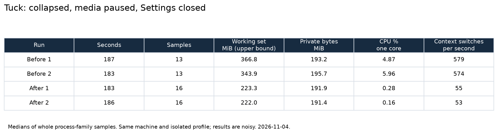
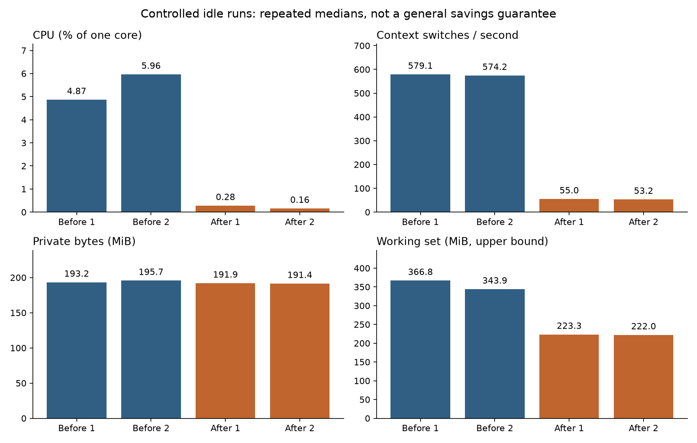
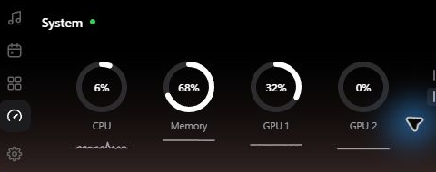
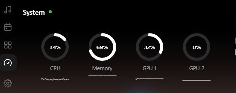

# Idle resource validation

Date: 2026-11-04. Windows release builds, same machine, same isolated WebView profile.
Baseline: `139deb32d013188284e441c75e69ea9abdf4349e` (`origin/main` at setup).

## Protocol

- Built both releases with real CMake, libclang, CPAL, and whisper-rs. CMake was installed outside the repository using Python's user package directory; existing LLVM supplied libclang. No stubs, browser flags, or Cargo configuration overrides.
- The measurement-only Tauri configuration changed `identifier` to `com.jojo.tuck-idle-audit`. This gives a separate single-instance mutex and app-data/profile directories. It was supplied from a temporary file with `--config`, never committed as production configuration.
- The owner's running Tuck at `C:/Users/Jojo/Desktop/Projects/tuck/src-tauri/target/release/tuck.exe` was never stopped or configured. Only the explicitly identified temporary baseline/after processes were stopped.
- The isolated profile uses the default notch and default service settings. Settings was explicitly closed. The island was collapsed, with the current Windows media session paused. Visualizer and clipboard capture remained at their default opt-in settings for the footprint comparison.
- Each controlled run lasts at least 180 seconds. Two baseline runs and two after runs use the same script. No native build or UI smoke test runs during the controlled samples. Other user applications remain running, so these are noisy desktop observations, not lab measurements.
- `footprint.ps1` adapts the research document's process-tree script to a specific root PID so it excludes the owner's copy. It sums the root plus every descendant, including WebView2 browser/render/GPU/helper processes.
- Working set and private bytes use Get-Process. CPU is cumulative process CPU time normalized by observed wall-clock elapsed time, as a percentage of one logical core. Context-switch counts come from Win32_PerfRawData_PerfProc_Thread, summed over family threads and differenced between samples. Thread exits between observations are not recovered, so churn can undercount context switches.
- CIM enumeration is slow on this machine: retained sample counts are lower than a fixed 5-second cadence suggests. Raw rows and actual durations are committed. The first sample, which has no CPU/context-switch delta, is discarded.
- Working set sums double-count shared pages and are an upper bound. Private bytes are committed private memory, not resident RAM. The charts describe these runs; they do not establish a universal savings percentage or isolate the contribution of individual fixes.
- Two exploratory baseline runs were excluded because the first-run Settings window could still be open. The initial after runs were also excluded when the final media diagnostic detected playback. With explicit owner approval, Spotify remote playback was paused for two fresh idle repeats. The retained after runs have before/after paused-state guards in `media-state-checks.json`. Only the final controlled JSON files in this directory enter the comparison.

## Implementation

- The visualizer worker parks on a condition variable unless the preference is enabled and the selected media state is active/playing. Pause/inactive/suspend drops capture; silent frames produce no spectrum IPC.
- Telemetry is request-driven, with fresh RAM/GPU samples on open and CPU re-priming after a gap. GPU adapters are cached until a display/settings notification invalidates them. No periodic telemetry push remains.
- Usage and extension events emit only when their snapshots change. Download/reminder detection remains live.
- Installed usage waits for its five-minute deadline or an explicit refresh signal, and parks indefinitely while disabled.
- Clipboard capture uses the lifecycle window's clipboard listener and a parked worker. Disabled means no listener. The arming path handles changes during registration; short per-notification retries handle clipboard contention.
- Cursor geometry is cached and invalidated on move/resize/DPI changes. Sampling stays at 40 ms within 200 CSS pixels of the island, and 120 ms farther away; click-through reconciliation and lifecycle pause gates remain intact.
- Wi-Fi is notification-driven, foreground changes refresh layout identity, and Caps Lock retains the compatible recent-input fallback described below.
- The main WebView targets Low after 30 seconds collapsed, and Normal on hover/peek/open. Obsolete queued trim requests are rejected by generation, including on the UI thread.
- Media seek/lyric ticks run only during playback. Open-page/session timers stop on collapse. The compact clock uses a minute-aligned timeout, active countdowns keep their required ticker, and hidden full-page animations are paused.

## Verification

Final commands and exit codes:

- `bun test`: 0; 127 passed.
- `bun run build`: 0 (also part of every UI smoke and Tauri build).
- `bun run test:ui`: three final consecutive runs, 0 / 0 / 0. Added checks for zero intervals with no media, zero intervals after collapsed playback pauses, and the compact clock advancing across a minute boundary without an interval.
- `cargo fmt --check`: 0.
- `cargo test`: 0; 130 passed across unit/integration suites, seven live hardware diagnostics ignored. Added playback eligibility and adaptive cursor/DPI boundary coverage.
- `cargo clippy --all-targets -- -D warnings`: 0.
- Baseline release build: 0. Final after release build and binary details are recorded with the measurements below.
- Read-only live Windows media diagnostic: 0, current session active but paused before controlled baseline sampling.

Initial setup/build attempts failed before CMake was on PATH; the retry passed with the real toolchain. Earlier new UI assertions exposed test-fixture mistakes (the browser demo plays media; the motion page uses a separate browser context), which were corrected before the final three passes.

## Residual work and limits

- Caps Lock has no ordinary global toggle broadcast. A second Raw Input keyboard registration would steal the process-wide registration from the protected dictation monitor. Caps Lock therefore retains the existing 250 ms receive timeout, but key-state sampling is gated on recent input or foreground changes. Keyboard layout refreshes on foreground changes, with a one-second fallback for changes within the same application. Wi-Fi uses WLAN notifications; only registration failure retains a 30-second fallback.
- TrySuspend is not enabled: the research audit marks Tauri/controller visibility handling as unverified. Notification delivery remains live. Low/Normal memory target calls are best effort and runtime-version dependent.
- Automated coverage includes lyrics parsing/timestamp behavior, HUDs, usage rings, downloads/activity presentation, clipboard privacy/generation handling, and lifecycle geometry. Live lyric synchronization during playback, real clipboard recording, physical sleep/resume, and a playing-audio footprint comparison remain unverified. No global clipboard write was performed, because the owner's Tuck could record it. Spotify transport was used only for the explicitly approved pause and restoration.
- The lifecycle suspend/resume path remains event-driven. Media suspension stops visualizer capture, resume rebinds media/desktop subscriptions and re-emits power, and cursor pause gates remain intact. This is code-path verification, not a physical sleep test.
- All protected lyrics/dictation, settings.html, updater, tray, release, and calendar layout files are unchanged.

## Reproduction

Run `powershell -File footprint.ps1 -RootId <isolated PID> -Seconds 180 -Output <run.json>` with the same settings and state. Render the committed JSON with `python render-measurements.py` (matplotlib required).

## Retained measurements

The guarded temporary after runs 3 and 4 are retained as `after-1.json` and `after-2.json`; the media-state guard file keeps their original phase numbers.

Whole-family medians, MiB = 1,048,576 bytes. CPU is percent of one core.

| Run | Seconds | Samples | Working set MiB | Private MiB | CPU median % | CPU min-max % | Context switches/s |
|---|---:|---:|---:|---:|---:|---:|---:|
| Before 1 | 187.3 | 13 | 366.8 | 193.2 | 4.87 | 2.88-7.01 | 579 |
| Before 2 | 183.0 | 13 | 343.9 | 195.7 | 5.96 | 2.65-8.05 | 574 |
| After 1 | 182.7 | 16 | 223.3 | 191.9 | 0.28 | 0.00-0.75 | 55 |
| After 2 | 185.6 | 16 | 222.0 | 191.4 | 0.16 | 0.00-1.03 | 53 |

Both retained after medians are lower than both baseline medians for CPU, working set, and context switches. Private committed memory is broadly unchanged; the working-set result must not be described as an equivalent reduction in committed memory. These are two desktop observations per build, with different background activity and sampling overhead, not a universal percentage saving.

## Native open-island evidence

The final release was reopened after the idle runs and navigated to Usage > System using the real native window. Two captures show the sampler continuing to update: whole-machine CPU changed from 6% to 14%, with live RAM/GPU values. The readings in these screenshots describe the whole machine; they are different from the Tuck process-family footprint above. JSON capture timestamps and accessibility readings accompany the images.

These are crops of the native window's content to exclude unrelated desktop content behind its transparent corners. No values or UI contents were replaced.

Rust commands were run from the worktree root using `--manifest-path src-tauri/Cargo.toml`. Build hashes and exit-code summaries are in `builds.json`.
